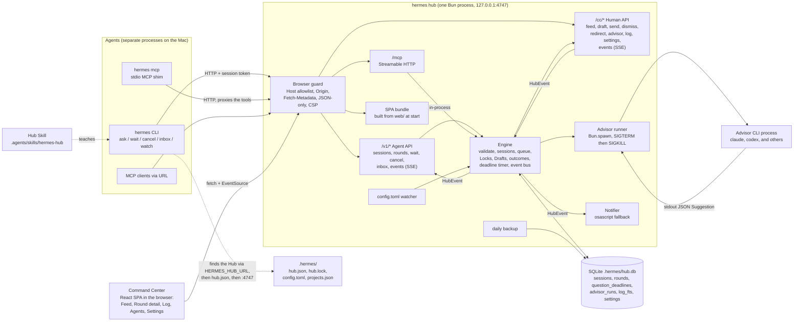
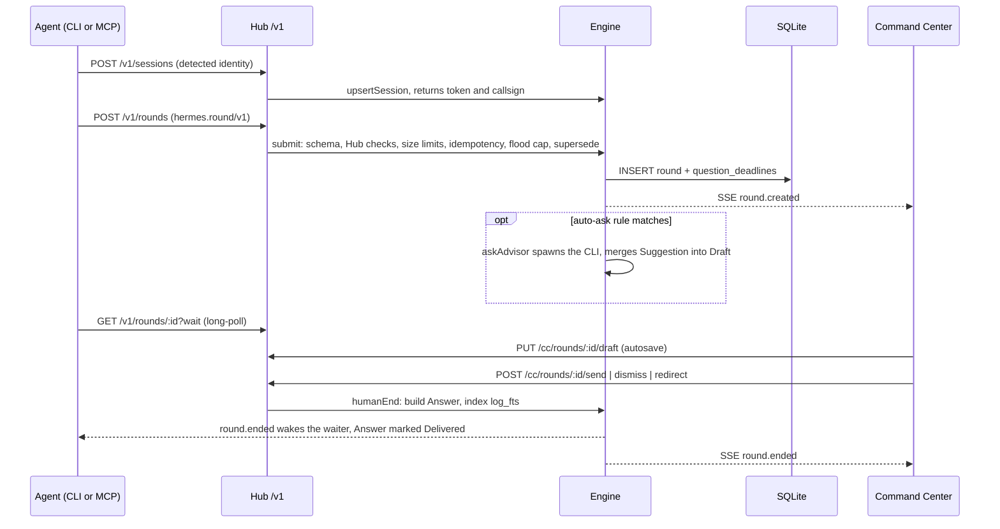
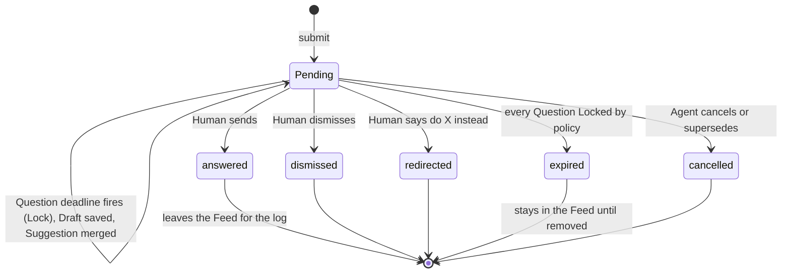
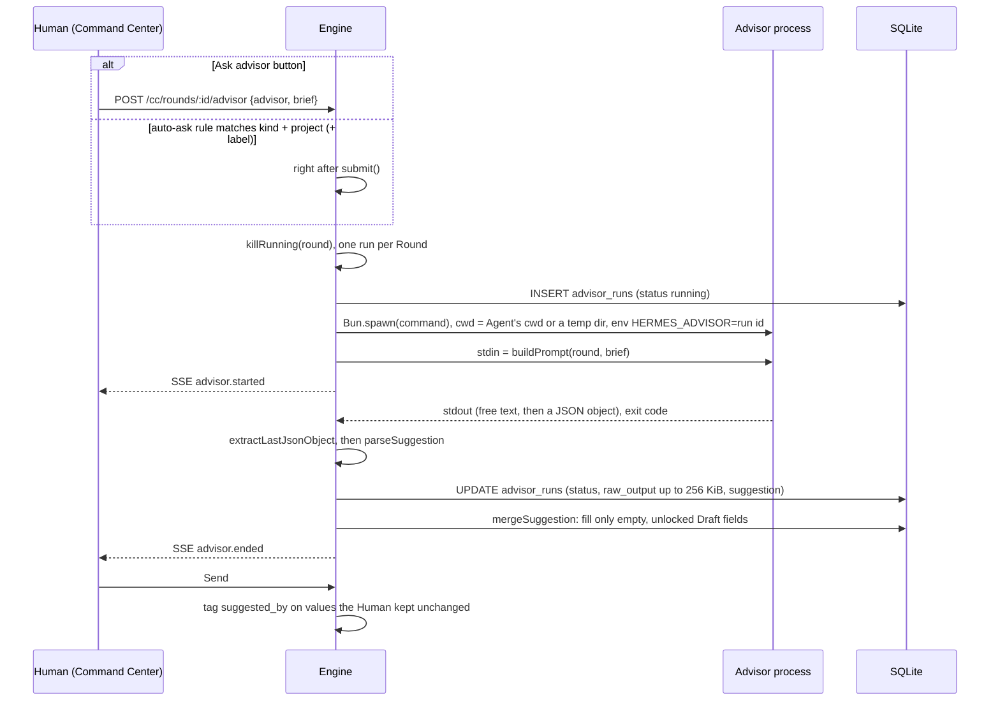

# Architecture

How Hermes Hub is put together, as built. The confirmed behaviour lives in the [specs](specs/README.md); this page explains how the code implements it. Terms follow [`GLOSSARY.md`](../GLOSSARY.md).

## One process, three doors, one engine

The Hub is a single Bun process listening on loopback (`127.0.0.1:4747` by default). Every way in, whether HTTP, MCP or CLI, ends up in the same `Engine` class (`src/hub/engine.ts`). The Engine owns all state in SQLite and publishes a typed `HubEvent` stream that feeds waiters, the CLI `watch` stream, the Command Center and notifications.



| Piece | Process | Code |
|---|---|---|
| Hub: HTTP server, Engine, SQLite, Advisor runner, Notifier | `hermes hub` | `src/hub/` |
| Command Center | the browser, loaded from the Hub | `web/src/` |
| Agents: the `hermes` CLI, the `hermes mcp` shim | one process per Agent command or session | `src/cli/`, `src/mcp/` |
| Advisor runs | one child process per run, started by the Hub | configured in `config.toml` |

### The doors

- **CLI** (`src/cli/main.ts`, `src/cli/client.ts`) and **stdio shim** (`src/mcp/shim.ts`) are thin HTTP clients of `/v1/*`. Each command, and each shim tool call, re-detects the Agent session and calls `POST /v1/sessions`. The token stays in memory.
- **`/mcp`** (`src/mcp/hub.ts`) runs in the Hub and calls the Engine directly. It identifies callers only from MCP `clientInfo` and per-call `_meta`. Without a per-call session id, all clients of one kind share one session (`CLAUDE·mcp`).
- All three expose the same five operations: submit, get, wait, cancel and inbox (`src/mcp/tools.ts` defines the MCP tool set over them).

### Why the Command Center is not a separate server

The Command Center is a React single-page app, but the Hub serves it. `buildCommandCenter()` in `src/hub/server.ts` bundles `web/` with `Bun.build` when the Hub starts and serves the result from memory at `/`, `/rounds/:id`, `/log`, `/agents`, `/settings` and `/assets/:file`. Its code runs in the browser and talks back to the same port: `fetch` for `/cc/*` (`web/src/api.ts`) and `EventSource("/cc/events")` (`web/src/store.ts`).

- **The Hub is headless.** Rounds queue up, deadlines fire and Advisors run with no tab open. When no tab can show a notification, `Notifier` (`src/hub/notify.ts`) posts a macOS notification instead.
- **One origin.** Serving the bundle ourselves, rather than as a route-level HTML import, puts every UI response under the browser guard and the CSP.
- **Only the Hub touches state.** The browser never opens `hub.db`; every Human action is an HTTP call into an Engine method (`send`, `dismiss`, `redirect`, `saveDraft`, …). That is also why the browser guard exists: other websites open in the same browser can send requests to `127.0.0.1`.

## A Round end to end



- **Identity** (`src/cli/identity.ts`). The CLI and shim work out the Agent kind and session key from env vars, the parent-process chain, MCP `clientInfo` and `_meta`. The Hub keeps one `sessions` row per `(kind, session_key)` and hands back a token, which identifies the session but does not authenticate it. Callsigns such as `CLAUDE·api-refactor` get a suffix only when two would clash (`src/hub/callsign.ts`). Liveness (Live, Idle or Gone) comes from `last_seen`, or from an active `wait`.
- **Submit** (`Engine.submit`). Checks run in this order: size cap, schema version, JSON-schema validation, Hub semantic checks (`src/schema/checks.ts`), attachment size, then idempotency (SHA-256 of the canonical JSON, scoped to the session). One transaction then handles supersede (cancel the old Round, take its queue position, carry the Draft over), the per-session flood cap, the insert and per-Question deadlines.
- **Wait** (`Engine.wait`). Resolves at once if the Round has ended; otherwise it subscribes to `round.ended` for that id, with a time bound and an abort signal. The first Answer returned sets `delivered_at`.
- **Ending** (`Engine.end`). This is the only place a Round reaches its Outcome. It kills any running Advisor, builds the `hermes.answer/v1` document, clears deadlines, writes the full-text index text (attachments excluded) and returns the `round.ended` event. The caller emits it after the transaction commits.

## Round lifecycle



- **Unanswered Policy.** `question_deadlines` holds absolute deadlines. One `setTimeout` (`Engine.schedule`, capped at 1 h so it never overflows) runs `fireDue`. `fireDue` Locks each due Question to its policy value; when every Question is Locked, the Round ends as `expired`.
- **Feed placement.** Outcomes the Human chose (answered, dismissed, redirected) leave the Feed at once. The others end in place and stay until the Human removes them (`feed_removed_at`).

## Advisors

An Advisor is a one-off run of an AI agent CLI that the Hub starts to suggest an Answer for a Pending Round. It only fills in suggestions; the Human always sends. Spec: [delegation.md](specs/delegation.md). Code: `src/hub/advisors.ts`, plus `askAdvisor`, `finishAdvisorRun` and `mergeSuggestion` in `src/hub/engine.ts`.



- **Config.** `[[advisor]]` takes `name`, `command` and `timeout_seconds` (default 300). `command` is a list of arguments and is never run through a shell. `[[auto_ask]]` takes `kind`, `project` and `advisor`, plus optional `label` and `brief`. Read-only operation is set through the CLI's own flags; the Hub cannot enforce it.
- **No loops.** With `HERMES_ADVISOR` set, the CLI and shim send a `Hermes-Advisor` header. The Hub rejects it with `advisor_cannot_ask`.
- **Prompt** (`buildPrompt`). Instructions, the Round (title, context, links, text Attachments), each Question with its options, Recommended option and Proposal, the exact value shape that Question accepts, the brief, and the output format.
- **Final status:**
  - `timed_out` if it ran past its timeout. A timeout or Cancel sends SIGTERM, then SIGKILL 5 s later.
  - `cancelled` if the Human cancelled it or a new run replaced it.
  - `succeeded` if it exits 0 and at least one Question's value is valid.
  - `failed` in every other case. The raw output is shown as an "unparsed briefing".
- **Validation.** Each suggested value goes through `parseHumanValue`, the check a Human's value gets. Invalid values are listed in `skipped`, and unknown Question ids are ignored.
- **Merge.** A Suggestion never overwrites a value the Human already set (it is offered inline instead) or a Locked Question.
- **Lifetime.** `end()` kills a running Advisor and clears the stored Suggestion, so a run never outlives its Round.

### Worked example

This was captured by driving the real `Engine` with a stub Advisor script standing in for an LLM CLI. A Codex Round has four Questions. Before asking, the Human had already typed `name = "orders_new"`. The brief is "Prefer what we already operate."

```toml
[[advisor]]
name = "stub"                     # in real use, e.g. ["claude", "-p", "--permission-mode", "plan"]
command = ["bun", "advisor.mjs"]
timeout_seconds = 30
```

**The prompt on stdin** (Questions part):

```
## db: Which database?
kind: single
options:
- postgres: Postgres
- mysql: MySQL
recommended: postgres
value: {"selected": "postgres" | "mysql"}

## envs: Roll out to?
kind: multi
options:
- staging: Staging
- prod: Prod
value: {"selected": [<one or more of "staging", "prod">]}
choose at least 1

## migrate: Run the migration now?
kind: approve
proposal (command):
bun run migrate
value: {"decision": "approve" | "reject", "edited": false}

## name: New table name?
kind: text
value: {"text": "<your answer, at most 63 characters>"}

Brief from the Human:
Prefer what we already operate.

Print exactly one JSON object as the LAST thing in your output, in this format (every key under "questions" must be
a Question id from above, and each "value" must use exactly the value shape listed under that Question):
{ "schema": "hermes.suggestion/v1", "summary": "…", "questions": { "<question id>": { "value": "…", "rationale": "Why." } } }
```

When `allow_other` is set, or a Proposal is editable, an extra `or:` line shows the alternative shape, for example `or: {"decision": "approve" | "reject", "edited": true, "proposal": "<the edited command>"}`.

**The Advisor's stdout:** a line of free text (with braces in it), then:

```json
{"schema":"hermes.suggestion/v1","summary":"Postgres in staging first; migrate now.",
 "questions":{
   "db":{"value":{"selected":"postgres"},"rationale":"Team already runs it in prod."},
   "envs":{"value":{"selected":["staging","qa"]},"rationale":"Stage first."},
   "migrate":{"value":{"decision":"approve","edited":false},"rationale":"Migration is reversible."},
   "name":{"value":{"text":"orders_v2"},"rationale":"Matches naming convention."},
   "bogus":{"value":1}}}
```

**What the Hub did:** the run status was `succeeded`, with `skipped: ["envs"]`.

| Question | Advisor said | Result | Why |
|---|---|---|---|
| `db` | `postgres` | filled into the Draft | the field was empty |
| `envs` | `["staging", "qa"]` | skipped | `qa` is not an option |
| `migrate` | approve | filled into the Draft | the field was empty |
| `name` | `orders_v2` | offered inline, not merged | the Human had already typed `orders_new` |
| `bogus` | `1` | ignored | no such Question |

**The Answer the Agent received** after the Human sent `db=postgres`, `envs=[staging]`, `migrate=reject` and `name=orders_new`:

```json
"db":      { "value": {"selected":"postgres"}, "set_by":"human", "suggested_by":"stub" },
"envs":    { "value": {"selected":["staging"]}, "set_by":"human" },
"migrate": { "value": {"decision":"reject","edited":false}, "set_by":"human" },
"name":    { "value": {"text":"orders_new"}, "set_by":"human" }
```

Every value is `set_by: "human"`. `suggested_by` appears only where the Human sent the Advisor's value unchanged: `db`, but not `migrate`, which the Human flipped to reject.

## Running the Hub

`hermes hub` (`src/hub/run.ts`):

- **Startup:**
  1. Refuses to start while migrations are pending.
  2. Takes `hub.lock` with a create-exclusive write; a lock held by a dead process is cleared and retried once.
  3. Tries up to 20 ports from the configured one.
  4. Writes `hub.json` so the CLI and shim can find it.
- **While running:** hot-reloads `config.toml`, makes a daily backup, and refreshes uncommitted Hub Skill copies.

SQLite tables (`src/db/migrations/`):

| Table | Holds |
|---|---|
| `sessions` | one row per Agent session: kind, key, label, cwd, git, detection signals, `last_seen`, `forgotten_at` |
| `rounds` | the submitted Round JSON, status, Answer, queue `position`, idempotency key and hash, `locks`, `draft`, current `suggestion`, `delivered_at`, `feed_removed_at` |
| `question_deadlines` | absolute deadline per open Question with an `apply_recommended` or `cancel` policy |
| `advisor_runs` | each Advisor run: trigger, brief, status, capped raw output, parsed Suggestion |
| `log_fts` | FTS5 text for the answered log, written when a Round ends |
| `settings` | Command Center live settings, one JSON document per key |
