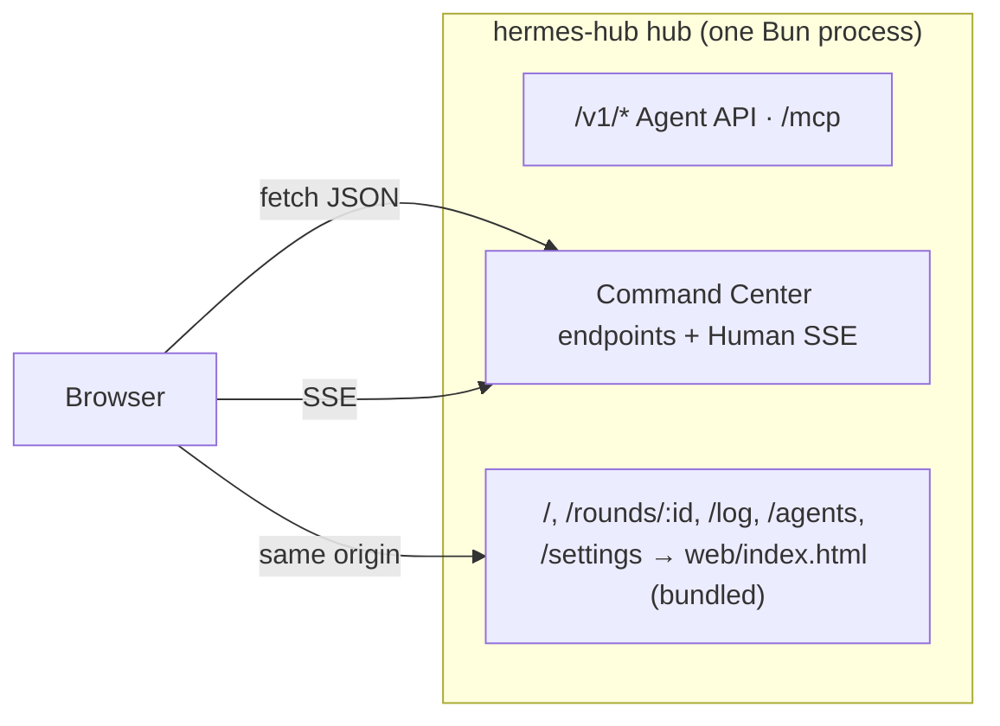

# Command Center front-end stack (v1)

Status: **confirmed by the Human on 2026-11-20**, ticket [What front-end stack does the Command Center use?](https://github.com/jazhou-adobe/hermes-hub/issues/15).

- **Builds on:** the [Command Center behaviour](command-center.md), [security](security.md) and [transports](transports.md) specs.
- **Design source:** [`jazhou-adobe/apollo-tokens`, `brands/hermes/design`](https://github.com/jazhou-adobe/apollo-tokens/tree/0b316ce29a5f18e14ddae1cfc4b2639a466ca9a1/brands/hermes/design) @ `0b316ce` (Flight Director 2169); the copied commit is recorded in [`web/design-system/SOURCE.md`](../../web/design-system/SOURCE.md).

## Decision

The Command Center is a **React 19 single-page app, written in TypeScript, bundled by Bun and served by the Hub itself**, from the same `Bun.serve` and origin as the API: `http://127.0.0.1:<port>`.

- One process.
- One command (`hermes-hub hub`, or `hermes-hub start` in the background).
- No Next.js.
- No second dev server.



## Layout in the repo

```
web/
├── index.html                 entry; Bun bundles the TSX and CSS it imports
├── src/
│   ├── main.tsx               mount
│   ├── shell.tsx              app bar, side nav, routes, toasts, live region, theme attributes
│   ├── router.ts              tiny History-API router (5 routes; no router dependency)
│   ├── store.ts               live store (see Data), clock offset, toasts and announcements
│   ├── api.ts                 typed fetch for actions; types from the Round/Answer schema
│   ├── notify.ts              browser notifications, permission, sound
│   ├── keys.tsx               key map, the `?` dialog, text-field guard
│   ├── app.css                design-system imports in the adoption order + glue for gaps still open in the master
│   ├── feed/ …                Feed, index, Round, Question, Attachment, action bar
│   └── detail/ … agents/ … log/ … settings/ …
├── preview/                   the approved static Feed preview (the visual reference) and GAPS.md
└── design-system/             copied per the adoption manifest (read-only here)
    ├── SOURCE.md              brand, master commit, theme, colour option, deviations
    ├── tokens/ (themes.css, tailwind-theme.css, tokens.json, worlds/flight-director.*)
    ├── hermes-components.css
    ├── fonts/ + fonts.css     self-hosted woff2 + @font-face setting --font-* variables
    └── foundations/ components/ patterns/ agent-contract/
```

The design master has no React widgets for these screens yet, so the components are written here from the preview's markup (the `.hh-*` classes); there is no `widgets/` folder.

## Serving

- **Routes:** the Hub's `Bun.serve` mounts `web/index.html` (an HTML import) on the UI routes. Bun bundles the TSX and CSS, with hot reload in development and minified assets in production.
- **Running from the clone** ([operations](hub-operations.md)): the Hub serves the Command Center **from source** through Bun's HTML import, building it on the fly. There are no embedded or released assets in Phase 1.
- **Security headers:** the browser guard and CSP from the security spec apply. No inline scripts or style attributes in the served HTML; React's `style` prop (CSSOM) sets the timer and progress custom properties. The CSP allows `font-src data:` because Bun inlines the fonts. Development hot reload is not covered by the CSP.
- **The `<html>` element** carries `data-theme="hermes-flight-director"` (Settings → Appearance can switch to `hermes-dark` or `hermes-light`, or change the colour option) and `data-density="compact"` for the Feed index.

## Styling

- **CSS import order** follows the adoption skill, without Tailwind:
  1. `themes.css`
  2. `hermes-components.css` in `layer(components)`
  3. the world stylesheet, unlayered
  4. the base layer from the design's `globals.css` (`base.css`)
- **No Tailwind.** Layout and component looks both come from the design's classes (`.hh-*`, including the Command Center layout classes added in apollo-tokens PR #1). `web/src/app.css` imports the design system and keeps only glue for gaps the master has not covered yet, each commented and listed in `web/preview/GAPS.md`. `tailwind-theme.css` stays copied for a future change.
- **Full width.** The shell, Feed column, Round strips, log table, Agents, Lanes and Settings span the viewport beside the side nav and the Feed index. Only typographic measures (`--hh-layout-measure` on prose, Question text and the search input) cap line length.
- **Motion** uses only the `--hh-motion-*` and `--hh-easing-*` tokens, and respects reduced motion (`foundations/motion.md`).

## Fonts

- **Self-hosted woff2** files ship with `hermes-hub`, so the Command Center works offline: Schibsted Grotesk, Spline Sans Mono, Big Shoulders (from the design repo), Archivo, IBM Plex Mono and Michroma. They are all SIL OFL.
- **`fonts.css`** declares the `@font-face` rules and sets the exact variables the tokens reference: `--font-schibsted-grotesk`, `--font-spline-sans-mono`, `--font-big-shoulders`, `--font-archivo`, `--font-ibm-plex-mono` and `--font-michroma`.
- **Recorded deviation:** the adoption skill's `next/font` step is replaced by this. `SOURCE.md` notes it.

## Design sync

- **Copy, never depend.** Run the adoption manifest (`apollo-tokens/.skills/apply-apollo-theme/scripts/theme-manifest.mjs hermes`) and copy every listed path into `web/design-system/`. Never copy `preview/*-preview.css`, `app/`, `research/`, `archive/` or `validation/`.
- **Widgets:** copied from `preview/components/hermes/` only as screens need them. They are plain React 19 with no Next.js imports. The `fixtures.ts` types are replaced by the Hub's schema types, and the sample data is never copied.
- **On a design change** (for example the additions brief), re-copy, update `SOURCE.md` with the new master commit, and fix the adapted widgets. Gaps found while building go back to the design master as contributions (its governance), never as one-off styles here.

## Data

- **`store.ts`** is a small external store: one module, plain objects, and selectors read through React's `useSyncExternalStore`. There is no data library.
  1. **Start:** the store loads a snapshot of Pending Rounds, sessions and Advisor runs.
  2. **Live:** it subscribes to the Human-scoped SSE stream. Events (`round.created`, `round.locked`, `round.ended`, `round.superseded`, `draft.saved`, `advisor.*`, `session.*`) patch it in place.
  3. **Reconnect:** it re-syncs and announces once, as the behaviour spec describes.
- **Actions** (send, dismiss, redirect, Ask advisor, Forget, settings) are `fetch` calls with JSON bodies (the browser guard requires JSON), and the UI updates from the resulting SSE events.
- **Drafts** are saved with a debounced `PUT` (≈ 500 ms after typing stops).
- **Timers** count down locally from the server's deadlines, corrected by the server clock offset sent when the stream opens. The Hub stays the authority on when a Lock fires.
- **Focus safety:** Rounds and Questions are keyed by id, so live updates never re-mount an input that has focus, and new Rounds append without moving scroll or focus.

## Implementation notes

- **Command Center endpoints** (internal, under `/cc/`): `rounds`, `rounds/:id` (Round detail, any status), `rounds/:id/{draft,send,dismiss,redirect,remove,advisor,advisor/cancel}`, `agents`, `agents/:id/forget`, `settings` (GET/PUT), `config` (read-only config.toml and storage), `notifications/permission`, `log`, `log/export`, and the Human SSE stream `events`.
- **Tests:** `bun test` covers the Hub side. `bun run test:browser` drives the installed Chrome with puppeteer-core against a real Hub: focus and scroll safety when a Round arrives, keys and auto-advance, reduced motion. axe-core (WCAG 2.2 AA tags) runs against the same pages.
- **Production bundling:** `Bun.build` with `minify`, hashed names under `/assets/`, and `NODE_ENV=production`.
