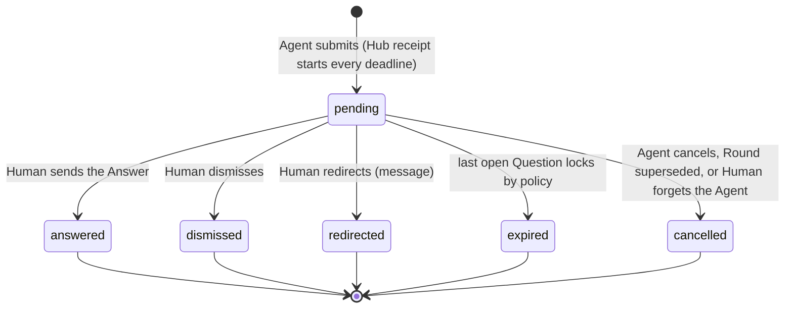
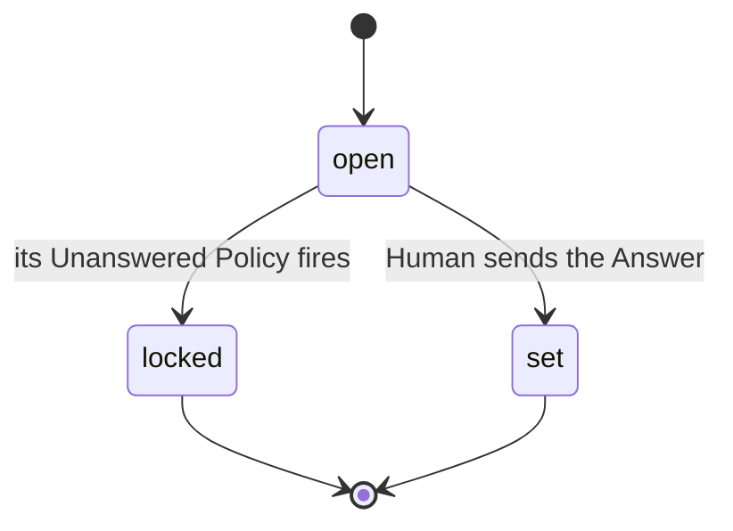

# Round lifecycle (v1)

Status: **confirmed by the Human on 2026-11-20**, ticket [How does a Round move through its lifecycle?](https://github.com/jazhou-adobe/hermes-hub/issues/7). It builds on the [Round and Answer schema](round-schema.md). Terms follow `GLOSSARY.md`.

## Round states

A Round is `pending` until it reaches exactly one terminal **Outcome**. Ended Rounds never change again.

## Question states inside a pending Round

- **Per-Question lock.** When a Question's deadline passes, it locks to its policy value and the Round stays open for the other Questions:
  - `apply_recommended` locks it to the Recommended option.
  - `cancel` locks it to `null`.
  - Either way, `set_by` is `policy`.
- **Locked Questions are read-only** in the Command Center. Any draft the Human had for one is kept as **Not sent**.
- **A Round expires** when no open Question remains and the Human has not sent. A Round with any `wait` Question therefore never expires on its own.
- **The strip timer** shows the Round's next deadline.

## Rules

1. **Deadlines are absolute.** `deadline = received_at + after_seconds`, stored with the Round. After a Hub restart, overdue policies fire at startup in deadline order, and `decided_at` is the time they actually fired.
2. **Strict deadlines.** A policy fires even while the Human is drafting. A policy never sends the Human's draft; the draft is kept as Not sent and shown in the answered log with Copy draft.
3. **Sending.**
   - Every **required** Question that is still open needs a value; locked Questions already count as set.
   - Values the Human gives carry `set_by: human`; locked values keep `set_by: policy`.
   - The Outcome is `answered`, and the Answer is delivered **immediately and is immutable**. There is no undo; the Agent asks again if a correction is needed.
4. **Dismiss and redirect** end the Round as `dismissed` or `redirected`. Open Questions get `value: null` with `set_by: none`. Locked Questions keep their policy values, because they really happened.
5. **Rounds are immutable for Agents.**
   - **Cancelling:** an Agent may cancel its own pending Round. The Outcome is `cancelled` with `cancelled_by: agent`.
   - **Changing:** to change a Round, the Agent submits a new one with `supersedes: <round id>`. In one step, the Hub:
     - checks that both Rounds come from the same Agent session (session token) and that the old Round is still pending;
     - cancels the old Round with `cancelled_by: agent` and `superseded_by: <new id>`;
     - places the new Round in the old Round's position in the queue;
     - carries over the Human's draft for Questions whose `id` and `kind` match.
   - **If the old Round has already ended,** the submission is rejected with an error that includes the old Round's Outcome, so the Agent collects the Answer instead.
6. **Forget Agent** (Human action) cancels the Agent's pending Rounds (`cancelled_by: human`) and hides the Agent from the roster until it next contacts the Hub. There is no token to revoke: session tokens are identity only ([security](security.md)).
7. **Rounds with no deadline** (`wait`) stay pending until the Human acts or the Agent cancels. There is no Hub-wide maximum age.
8. **Delivery tracking.** `delivered_at` is set the first time an ended Round's Answer is returned to the Agent over any transport. Ended Rounds without it show **Not picked up** in the answered log. Delivery is an attribute of the Round, not a state.
9. **Liveness is implicit.**
   - Any request carrying an Agent session's token updates its `last_seen`.
   - **Live** means the session has an open wait or was seen in the last 2 minutes; **Idle** means seen within 30 minutes; **Gone** means not seen for longer. Both thresholds are Hub settings.
   - Liveness never changes a Round's state. A gone Agent's Rounds stay answerable, and the Answer waits for its next poll.
10. **Idempotency.**
    - `idempotency_key` is scoped to the Agent session (session token) and kept forever.
    - Same key with the same body returns the existing Round in whatever state it is in.
    - Same key with a different body is rejected with a conflict error.
    - "Same body" means equal canonical JSON of the submitted Round.
11. **Flood cap.**
    - At most **10 pending Rounds per Agent session**; this is a Hub setting.
    - Submitting over the cap is rejected with an error naming the cap and the session's oldest pending Round.
    - A superseding submission is checked after the old Round is cancelled, so it never trips the cap.
12. **What a waiting Agent sees.** While pending: only `pending` and the next deadline; locked values are not revealed early. Once ended: the full Answer document, whatever the Outcome. The framing on each door is in [transports.md](transports.md).

## Schema additions (additive, stays v1)

| Where | Field | Meaning |
|---|---|---|
| Round | `supersedes` | Id of a pending Round from the same Agent session that this Round replaces. |
| Answer | `cancelled_by` | `agent` or `human`; present only when the Outcome is `cancelled`. |
| Answer | `superseded_by` | Id of the replacing Round; present only when it was superseded. |

## Left to other tickets

- **Transport:** settled in [transports.md](transports.md): wait framing, cancel and supersede on each door, error codes, and delivery for MCP Tasks.
- **Agent identity:** settled in [agent-identity.md](agent-identity.md). An Agent session is (kind, session key), and a resumed process keeps its session.
- **Security:** settled in [security.md](security.md); there are no credentials to revoke.
- **Delegation:** settled in [delegation.md](delegation.md). Advisor runs never pause deadlines, a Locked Question ignores a Suggestion, and the Round ending stops the run.
