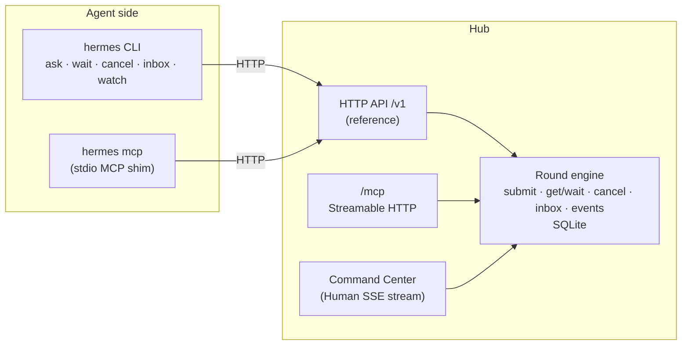

# Transports (v1)

Status: **confirmed by the Human on 2026-11-20**, ticket [How do the HTTP API, MCP server and file mailbox coexist over one Round lifecycle?](https://github.com/jazhou-adobe/hermes-hub/issues/8). It builds on the [schema](round-schema.md) and the [lifecycle](round-lifecycle.md). Terms follow `GLOSSARY.md`.

**No file mailbox. Local only.** The Human dropped the mailbox, and the [security spec](security.md) binds the Hub to `127.0.0.1` with session tokens used for identity only. Agents whose sandbox blocks localhost are configured once per tool so that `hermes` may reach `127.0.0.1:<port>`; the Hub Skill ships the snippets.

## Shape: one core, HTTP as the reference



- The Hub's **Round engine** exposes five operations: **submit, get/wait, cancel, inbox, events**. Every door (HTTP, `/mcp`, the stdio shim, the CLI) maps 1:1 onto them with identical semantics and error codes.
- **HTTP is the reference:** this spec defines each operation over HTTP first; the other doors are mappings.
- One conformance test suite runs the same scenarios through every door.

## The five operations

| Operation | Meaning | Lifecycle hooks |
|---|---|---|
| **submit** | Validate a Round, apply `idempotency_key` and `supersedes`, check the flood cap, persist it. Returns `{round_id, url, status}`. | Deadlines start now. A replay with the same key and body returns the existing Round. |
| **get / wait** | Return the Round's state: `{status: "pending", next_deadline}` while pending, or the full Answer once ended. `wait` holds the request until the Round ends or the window closes. | The first return of an ended Answer sets `delivered_at`. An open wait marks the session **Live**. |
| **cancel** | The Agent cancels its own pending Round. | Outcome `cancelled`, `cancelled_by: agent`. Cancelling an ended Round fails with `round_ended`, and the response includes its Outcome. |
| **inbox** | List the caller's ended Rounds that have not been delivered yet, oldest first. | Returning an Answer here sets `delivered_at`. |
| **events** | A stream of the caller's Round endings, one event per ended Round, with catch-up from a cursor. | Delivering an event counts as delivery. |

The **caller** is the Agent session (identity ticket), authenticated by its token (security ticket).

## HTTP (reference)

| Operation | Request | Success |
|---|---|---|
| submit | `POST /v1/rounds` (body: Round) | `201` new Round, or `200` idempotent replay: `{round_id, url, status}` |
| get | `GET /v1/rounds/{id}` | `200` `{status: "pending", next_deadline}` or an Answer |
| wait | `GET /v1/rounds/{id}?wait=25` (1–55 s) | Same as get. Returns as soon as the Round ends, otherwise when the window closes. |
| cancel | `POST /v1/rounds/{id}/cancel` | `200` with the Answer (`outcome: cancelled`) |
| inbox | `GET /v1/inbox?limit=50` | `200` `{answers: [...]}` |
| events | `GET /v1/events` (SSE; `Last-Event-ID` for catch-up) | `event: round.ended`, `data: <Answer>` |
| hub info | `GET /v1/hub` | `{hub_id, version, schemas: ["hermes.round/v1"], limits}` |

- Wait requests disable Bun's 10 s idle timeout per request (`server.timeout(req, 0)`). SSE sends a comment heartbeat every 15 s.
- The Command Center has its own Human-scoped stream and endpoints, which are not part of the Agent API.

## Errors (every door)

Each error has a stable `code`. Over HTTP it is sent as `application/problem+json` ([RFC 9457](https://www.rfc-editor.org/rfc/rfc9457)) with `{type, title, status, detail, code, ...}`.

| `code` | HTTP | When | Extra fields |
|---|---|---|---|
| `invalid_round` | 422 | Schema or Hub validation failed (for example `apply_recommended` with no Recommended option) | `errors[]` (JSON pointer + message) |
| `too_large` | 413 | An attachment or Round size cap was exceeded | `limit`, `pointer` |
| `unsupported_schema` | 422 | Unknown major schema version | `supported[]` |
| `idempotency_conflict` | 409 | Same key, different body | `round_id` |
| `round_ended` | 409 | Superseding or cancelling a Round that has already ended | `round_id`, `outcome` |
| `not_found` | 404 | Unknown Round, or a Round owned by another caller | |
| `flood_cap` | 429 | More than the allowed number of pending Rounds for the session | `limit`, `oldest_round_id` |
| `unknown_session` | 401 | Missing or unknown `Hermes-Session` token on an endpoint that needs a session | |
| `forbidden` | 403 | Host or Origin refused by the browser guard (security spec) | |
| `advisor_cannot_ask` | 403 | A session or Round requested from an Advisor run (`HERMES_ADVISOR` set; [delegation spec](delegation.md)) | |
| `hub_unavailable` | — | Client side only: the Hub can't be reached (it is down, or a sandbox blocks the connection). The message points to the Hub Skill's sandbox setup. | |

## MCP

Two hosts, one tool set:

- **`hermes mcp`**, a stdio shim that proxies to HTTP. This is the default. It has no first-byte timer, it inherits the Agent's environment for identity detection, and, like the CLI, it calls `POST /v1/sessions` for the detected identity (on every tool call, since it re-detects per call; [agent-identity.md](agent-identity.md)), keeping the token in memory.
- **`/mcp`** on the Hub, Streamable HTTP on revision 2026-07-28, legacy-stateless for 2025-era clients (2025-11-25 and the earlier 2025 revisions, such as the 2025-06-18 that Codex 0.133 sends), loopback only. It serves clients that prefer a URL. Identity comes from `clientInfo` and per-call `_meta`, and the session token from `POST /v1/sessions`.

| Tool | Input | Behaviour |
|---|---|---|
| `hermes_ask` | `{round}` | **Adaptive:**<br>• If the request declares the Tasks extension, return `resultType: "task"` with `taskId` = Round id. `tasks/get` answers `working` while pending and `completed` with the Answer once ended; `tasks/cancel` maps to cancel.<br>• Otherwise, block for up to **50 s** with progress notifications. Return the Answer if the Round ended; if not, return `{status: "pending", round_id, next_deadline}` and tell the Agent to call `hermes_wait`. |
| `hermes_wait` | `{round_id}` | Block for up to 50 s, then the same result as above. |
| `hermes_cancel` | `{round_id}` | cancel |
| `hermes_inbox` | `{}` | inbox |

- **Errors:** a tool result with `isError: true` and `structuredContent: {code, ...}` using the same codes.
- **Delivery:** a Tasks Answer counts as delivered on the first `tasks/get` that returns it as `completed`.
- **Not in Phase 1:** URL-mode and form-mode elicitation.
- **Pinned at implementation ([S7](https://github.com/jazhou-adobe/hermes-hub/issues/29)):**
  - Both hosts negotiate 2026-07-28 or any 2025 revision (the stdio shim pins the era per connection). The Tasks extension is declared in the server capabilities and honoured only on a 2026-07-28 request that declares it in its own `clientCapabilities`.
  - The blocking wait sends `notifications/progress` every 10 s when the call carries a `progressToken`.
  - A task is `{taskId, status, createdAt, lastUpdatedAt, ttlMs: null, pollIntervalMs: 5000}`. A Round cancelled by its Agent reads `cancelled`; every other ended Round reads `completed` with the Answer as the tool result.
  - `tasks/cancel` always acknowledges with `{}`, also when the Round had already ended. An unknown or foreign Round is `-32602`; a request that does not declare Tasks is `-32021`; other Hub errors are `-32603` with `data: {code, ...}`.
  - `hermes_wait` and `hermes_cancel` without a `round_id` fail with `not_found`; `hermes_ask` without a `round` object fails with `invalid_round`.
  - The text content of each result repeats the structured one (`ERROR <code> <message>` for errors, as on the CLI).

## CLI (`hermes`)

| Command | Does |
|---|---|
| `hermes ask <file\|-> [--wait\|--no-wait] [--out <file>] [--supersedes <id>]` | submit, then wait in a loop of 25 s long-polls unless `--no-wait` |
| `hermes wait <id> [--out <file>]` | wait in a loop until the Round ends |
| `hermes cancel <id>` | cancel |
| `hermes inbox [--format lines\|json]` | inbox |
| `hermes watch` | events; one `ANSWER` line per ended Round, for Monitor and notify-style tools |
| `hermes mcp` | the stdio MCP shim |
| `hermes hub` | starts the Hub (manual start) |

**Output (line markers):**

```
ROUND r_01jd3k8w2m http://127.0.0.1:<port>/rounds/r_01jd3k8w2m
ANSWER {"schema":"hermes.answer/v1","round_id":"r_01jd3k8w2m","outcome":"answered",...}
```

- The `ROUND` line is printed as soon as the Round is accepted.
- `ANSWER` is printed on one line when the Round ends, and is also written to `--out`.
- With `--no-wait`, only `ROUND` is printed.
- Errors print `ERROR <code> <message>`.
- While waiting, a lost connection is retried with backoff, because the Round is safe in the Hub. `hub_unavailable` is reported only if the Hub cannot be reached at submit time, or stays unreachable for 5 minutes.

**Exit codes:** `0` for any ended Round, whatever its Outcome; Agents read `outcome`. Failures:

| Exit | Meaning |
|---|---|
| `2` | Usage error |
| `3` | `hub_unavailable` |
| `4` | Rejected: `invalid_round`, `too_large`, `unsupported_schema`, `idempotency_conflict`, `round_ended`, `flood_cap`, `not_found`, `advisor_cannot_ask` |
| `5` | `unknown_session` or `forbidden` |

## Left to other tickets

- **Security:** settled in [security.md](security.md): local only, a session token as the `Hermes-Session` header, and the browser guard.
- **Agent identity:** settled in [agent-identity.md](agent-identity.md): detection, `POST /v1/sessions` on every CLI run, and discovery via `HERMES_HUB_URL` → `<hermes's own clone>/.hermes/hub.json` → `http://127.0.0.1:4747` ([operations](hub-operations.md)).
- **Hub Skill:** settled in [hub-skill.md](hub-skill.md): CLI by default, MCP Tasks on Claude Code (taught through the MCP tool descriptions), and `hermes doctor` for the sandbox snippets.
- **Claude Code hooks adapter:** dropped. Agents run `hermes inbox` after resuming ([hub-skill.md](hub-skill.md)).
